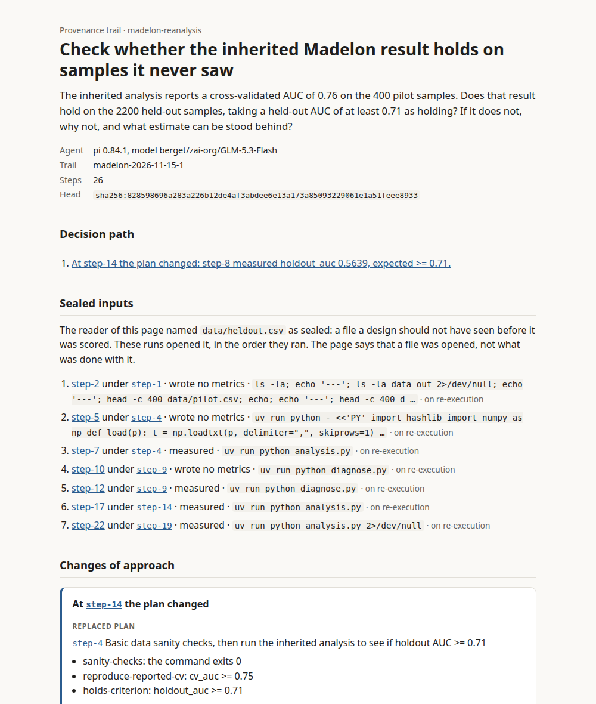
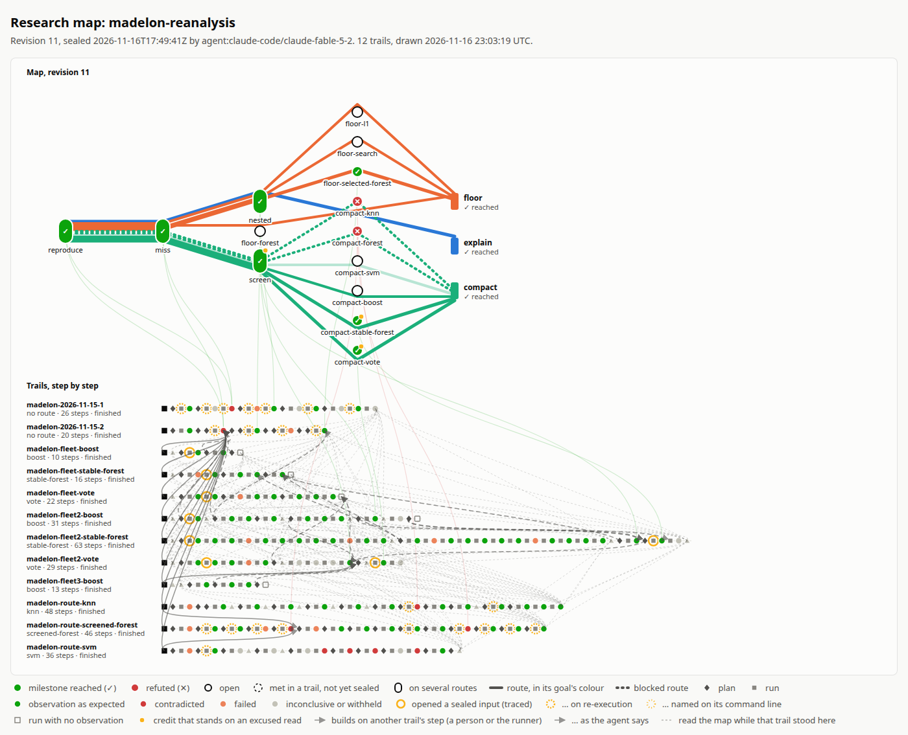

# Provenance notebook

A record of an AI-assisted research task that a reviewer who was not there can read and check:
what was planned and why, what was run, what contradicted the plan, and how the plan changed.

It is an entry for Task 2 of the [AI for Meta-Science
Hackathon](https://ai4metascience-hackathon.stockholm.ai/), 10–17 November 2026. The brief's test
is that a reviewer can answer "why did they change approach at step 4?" from the log alone.

The notebook has four parts:

- **A trail.** One directory per task, `steps/step-N.json`, each file written once and chained to
  the one before by its hash. A step is a task, a plan, a run, an observation, a review or a note.
- **Capture.** An extension for the [Pi coding agent](https://github.com/earendil-works/pi) that
  writes the trail from hooks around the agent's tools. The agent does not write it.
- **The reviewer's page.** One self-contained HTML file generated from a trail, and `trail.py why`,
  which answers the brief's question in text.
- **A research map.** Many trails toward shared goals, with a checker that recomputes every credit
  from the step files and records every credit that was withdrawn.

## The brief's question, answered from a live trail

An agent (GLM-5.3-Flash under Pi) was given an inherited analysis that reports a cross-validated
AUC of 0.76, and asked whether it holds on 2200 held-out samples. This is the answer `why` prints
for the step where its plan changed. Nothing in it is inferred: each line is a link or a field of
a step.

```text
$ uv run python trail.py why live/madelon-2026-11-15-1 step-14 --store live/store \
    --reads research/madelon-reanalysis/retrace/madelon-2026-11-15-1.json --sealed data/heldout.csv
Change of approach at step-14
Replaced plan: step-4, Basic data sanity checks, then run the inherited analysis to see if holdout AUC >= 0.71
Trigger: step-8, contradicted
  holdout_auc 0.5639, expected >= 0.71 (holds-criterion)
New plan: step-14, Rewrite analysis.py: selection + all tuning nested in CV, tuned on pilot only, one held-out scoring
Reasoning:
Diagnosis confirmed: cv_auc 0.76 was inflated by selecting features on all pilot data before CV; […]
Before it was proposed: 5 runs had opened data/heldout.csv: step-2 (wrote no metrics), step-5 (wrote
no metrics), step-7 (measured), step-10 (wrote no metrics), step-12 (measured); known on re-execution
```

The last line is the part a transcript does not give a reviewer. The new plan promises "one
held-out scoring", and the trail shows that five earlier commands had already opened the
held-out file. One of them, `diagnose.py` at step 12, printed per-feature AUCs on it, and the
plan's reasoning quotes one. The page reports the reads and leaves the judgment to the reader.



## Why it is more than a log

- **Expectations come before results.** A plan commits to a measure and a threshold before its
  run, so a reader sees whether a result was predicted or explained afterwards.
- **Outcomes are recomputed.** The checker derives each outcome from the measures, and reads the
  measures again from the metrics file the run wrote. An agent does not grade its own run.
- **What failed stays.** A run is recorded before its command starts, so a crash or an abandoned
  attempt cannot drop out. `trail.py facts` lists what a reviewer would ask about: a plan re-run
  until it held, an eased threshold, a run that never settled.
- **What a run opened is recorded.** Each command is traced, so reading a held-out file is a fact
  of the trail, not something a reader must find in the code.
- **A citation is stable.** A trail is cited at the hash of its last step. One that was rewritten
  and re-chained still checks, but no longer has the head it was cited at.

## What was run, and what it showed

Every live attempt is committed under `live/`: twelve trails, all by the same model.

| What | Result | Where |
| --- | --- | --- |
| Two live runs of the task | Both saw the inherited result miss (0.56 against a floor of 0.71). One recorded a replacement plan; the other recorded none | [evidence/](evidence/README.md) |
| A forgery, in five stages | An edited number breaks the chain. Re-chaining passes `check` and fails against the stored metrics file. Forging that file too is caught only by a head cited beforehand | [tamper.txt](evidence/madelon-2026-11-15-1/tamper.txt) |
| A reader check: three models answer fixed questions from the page, and from the agent's raw transcript | **The page was not needed.** A model answers as well from the transcript. The page's measured advantage is its length, a tenth of the transcript's, which let a small-context model answer at all | [evidence/](evidence/README.md#the-reader-check) |
| Re-executing five trails under a file trace | Two credits were withdrawn: designs judged "pilot-only" from their command lines had opened the held-out file. 17 of 17 metrics files were reproduced byte for byte | [the map](research/madelon-reanalysis/README.md#checked-not-judged) |
| Two fleets of three agents sharing one map | The first reached nothing. In the second, agents built on each other's steps and two routes reached the goal; one held-out result leaked between agents, and the leak is disclosed and closed | [the map](research/madelon-reanalysis/README.md#agents-sharing-the-map) |
| One agent in a sandbox | FLEET3_RESULT | [the map](research/madelon-reanalysis/README.md#the-sandboxed-run) |

The demo task is constructed: the inherited script was written for this repository to show a
known pitfall (feature selection outside cross-validation) on public data. No published analysis
is being corrected.



## Try it

Requires [uv](https://docs.astral.sh/uv/). Capture's tests also need Node.js 24, `strace` and
`bwrap`, and are skipped without them. No model or key is needed for anything below.

```sh
uv sync
uv run pytest
uv run python trail.py check live/madelon-2026-11-15-1 --store live/store
uv run python trail.py why   live/madelon-2026-11-15-1 --store live/store
uv run python trail.py facts live/madelon-2026-11-15-1 --store live/store
scripts/site.sh site                             # the pages, then open site/index.html
uv run python project.py serve research/madelon-reanalysis/map --live live    # http://127.0.0.1:8077/
```

To see the tamper evidence on a trail of your own choosing:

```sh
uv run python trail.py head   examples/churn-model-2026-11-11      # the digest to cite
uv run python trail.py verify examples/churn-model-2026-11-11 sha256:…
```

`verify` passes for any head the trail has had, so a trail that grew still resolves. It fails for
a trail whose past was rewritten, however well that trail checks.

Running an agent under capture needs Pi (`npm ci --prefix capture`) and a model:
`scripts/live.sh demo NAME --provider … --model …`. [capture/README.md](capture/README.md) has
the details, and a scripted provider that replays tool calls with no model.

## Commands

| Command | Does |
| --- | --- |
| `trail.py check DIR [--store STORE]` | Checks the chain, who wrote what, and that outcomes follow from the measures. With a store, that the measures are the ones the run wrote |
| `trail.py why DIR [STEP]` | Answers "why did the plan change at STEP?" from the links alone |
| `trail.py view DIR [--code REPO]` | Writes the reviewer's page |
| `trail.py facts DIR` | Lists what a checked trail shows without judging it |
| `… --reads FILE --sealed PATH` | For `why`, `view` and `facts`: which runs had opened PATH before each plan |
| `trail.py head DIR`, `verify DIR HEAD` | Prints the digest a trail is cited at; says whether the trail ever had a head |
| `trail.py review DIR STEP …`, `note DIR STEP …` | Appends a person's review or note |
| `trail.py graph DIR`, `merge OUT DIR…` | Exports trails as node and edge tables |
| `project.py check MAP --live DIR` | Recomputes every credit of a research map from the trails |
| `project.py view`, `shared`, `next`, `status` | The map as text, what routes share, what to run next, and the live state |
| `project.py propose`, `seal` | Drafts the next revision from the trails; seals it |
| `project.py page`, `serve` | The map as one static page, or live on 127.0.0.1 |
| `retrace.py DIR` | Re-executes a trail's runs from their code snapshots under a file trace |
| `tamper.py DIR …` | Runs the forgery sequence on a copy of a trail |
| `readers.py texts`, `ask`, `grade` | The reader check |
| `scripts/live.sh`, `scripts/fleet.sh` | One agent under capture; up to three at once on one map |

## What it does not prove

- **Who wrote a step.** The chain proves order, and that nothing changed after a head was cited.
  Authorship rests on the capture host. `seal --by` and `review --by` take a name as text.
- **A complete rewrite of an uncited trail.** A forged trail with forged metrics files is caught
  only by a head that was cited somewhere the forger cannot reach.
- **What a read was used for.** A trace says a file was opened. Whether it fed a design is a
  judgment, made by a reader or in a map revision's stated reason.
- **That a run used the method it claims.** `check` recomputes numbers, not methods. The map's
  second revision exists because two method claims were wrong and passed.
- **Containment.** The sandbox hides named places: the repository, the trails, the map, the other
  agents' workspaces. The rest of the machine stays readable and the network open. Single runs
  with `live.sh` are not sandboxed unless asked.
- **Privacy.** Commands are recorded as typed. The design's redactor and keyed digests are not
  built, so the committed trails hold absolute paths of the machine they ran on.
- **A person's judgment.** MAP_SIGNED
- **Generality.** One task, one model, one agent host. The reader check used models as readers.

## Layout

| Path | Contents |
| --- | --- |
| `trail.py`, `step.schema.json`, `view.py` | The checker, the schema of one step, and the reviewer's page |
| `capture/` | The Pi extension that writes steps as the agent works, and its scripted provider |
| `project.py`, `mapview.py` | Research maps: the checker, and the page that draws them |
| `retrace.py`, `tamper.py`, `readers.py` | Re-execution under a trace, the forgery sequence, the reader check |
| `demo/` | The task: an inherited analysis with a known pitfall |
| `live/` | Every trail an agent wrote, with its transcript and code snapshots |
| `evidence/`, `research/` | What was measured on the live trail; the research map over all trails |
| `examples/` | Three constructed trails, used as test fixtures |
| `docs/` | [The pitch](docs/HACKATHON.md), [the step format](docs/DESIGN.md), [the graph export](docs/GRAPH.md), and one [spec](docs/specs/) per piece of work |

## How it was built

From specs, by AI coding agents, one branch and pull request per spec; [PLAN.md](PLAN.md) is the
roadmap and its decisions. The step schema, the checker and the three example trails predate the
hackathon's start on 10 November and came in with the first commit. Everything else was built
during the week.

Licensed under the [MIT License](LICENSE).
